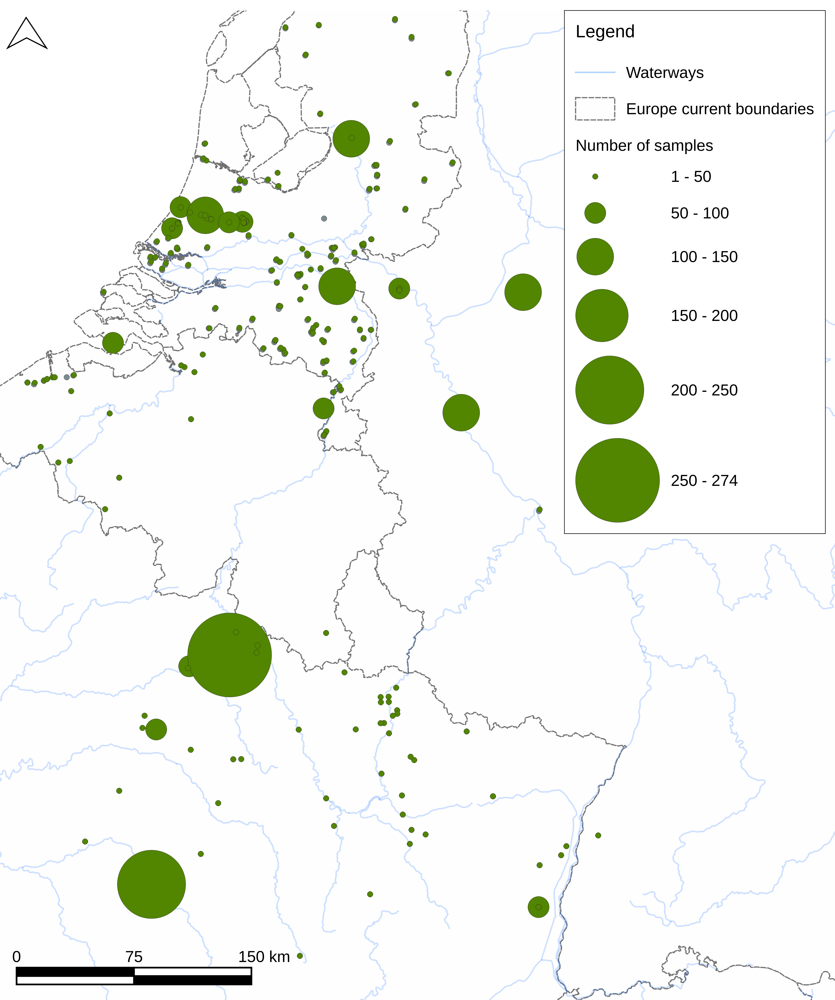
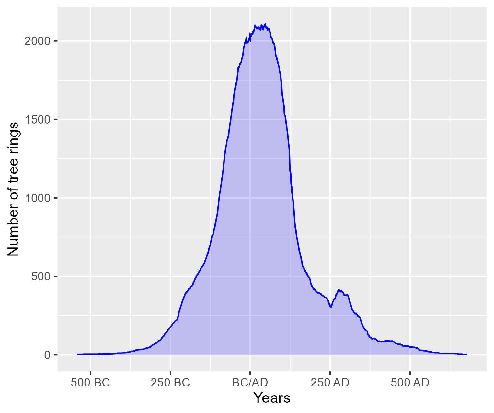
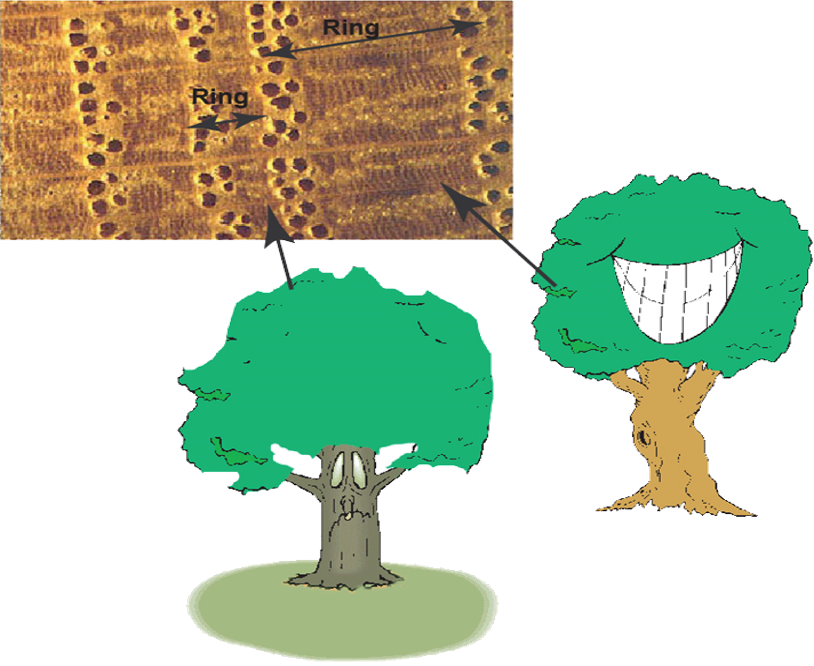
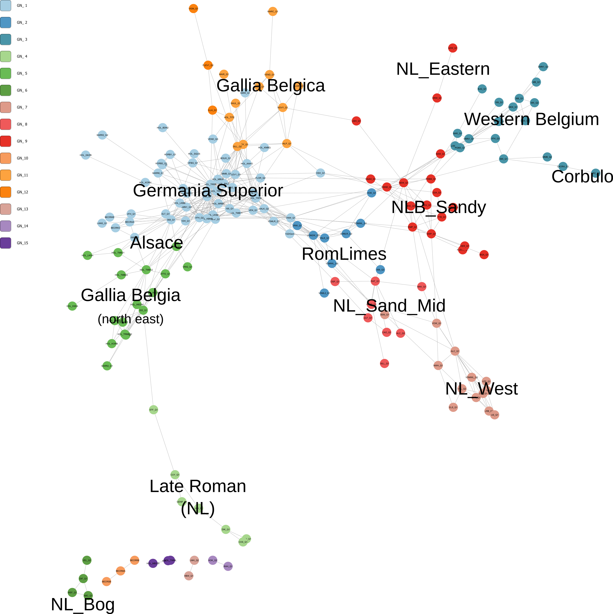
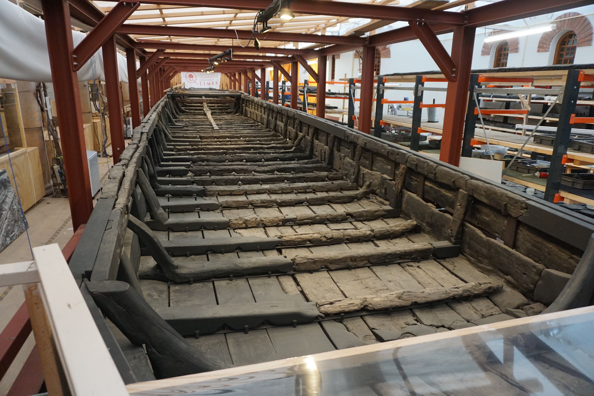

## Inhalt

::: columns
::: {.column width="75%"}

-   Holz in der römischer Zeit
-   Daten und Interdizicplinarität
-   Herkunft: Dendroprovenance
-   Netzwerkanalyse Jahrringdaten
-   Archäologische Interpretation
-   Holztransport
-   Abschluss

:::
::: {.column width="25%"}

:::
:::

## Holz: primäre Ressource

::: columns
::: {.column width="65%"}
::: {style="font-size: 70%;"}
-   Erneuerbar: wachst im Wald
-   Primäre Ressource für z.B.
    -   Bau
    -   Infrastruktur
    -   Heating
    -   Tools
:::

![[Quelle: @visser2025, Figure 04.05]](images/Figure_04.05_CoppicedOak_Laarsenberg(NL)_new.JPG){width="50%" fig-align="left" cap-skip="0pt"}
:::

::: {.column width="35%"}
![[Quelle: @visser2025, Figure 06.07]](images/Figure_06.07_Post_ForumHadriani.JPG)
:::
:::

## Römisches Holz

::: columns
::: {.column width="60%"}
#### Das Problem

-   Zahlreiche Holzfunde aus die römischer Zeit
-   Fundort genau dokumentiert
-   Holzherkunft (Wachstumsregion) unbekannt

#### Forschungsfrage

-   Wie war die römische Holzbeschaffung während die erste vier Jahrhunderten organisiert in Nordwesteuropa?

    -   Herkunft
    -   Transport
:::

::: {.column width="40%"}
![[Quelle: @visser2025, Figure 01.01]](images/Figure_01.01_Research_area_print.png)
:::
:::

## Interdisziplinarität

![[Quelle: @visser2025, Figure 03.02]](images/Figure_03.02_Data_sources.png){fig-align="center"}

## Dendrochronologische Daten: "bias"

::: columns
::: {.column width="70%"}
{width="65%" fig-align="center"}
:::

::: {.column width="30%"}

::: {style="font-size: 60%;"}
[Quelle right figure: @visser2025, Figure 03.17] [Quelle left figure: @visser2025, Figure 03.10]
:::

*Sparse big data*:

-   meistens Eiche (Quercus spp.)
-   Räumlich
-   Zeitlich
:::
:::

## Forschungsgeschichte (NL)

![[Quelle: @visser2025, Figure 03.19]](images/Figure_03.19_tree_ring_research_vs_arch_research_nl.png)

# Herkunftbestimmung {.center background-image="images/00_Front_no_text_20250502.png" background-opacity="0.4"}

## Wachstum der Jahresringen:

::: columns
::: {.column width="60%"}
-   Jährlich wachst ein ring (Kambium: Aussenseite des Bäumes)
-   Jahrringbreite wird beeinflusst durch
    -   Bodem
    -   Klima
    -   Lokale Faktoren
    -   Waldstörungen
-   Wachstum: Frühjahr bis Herbst
:::

::: {.column width="40%"}

:::
:::

## Lebensgeschichte archaeologisches Holz

![Life history of archaeological wood [Quelle: @visser2025, Figure 03.05]](images/Figure_03.05_Tree_life_history_2022.png)

## Dendroprovenance (Herkunftbestimmung)

Herkunft von Bäume/Holz meistens bestimmt auf statistische Übereinstimmung of Jahrringkurven mit (regional)Kalender

### Problemen

-   Oft basiert auf nur ein statistische Wert
-   Synchronisierung von nur ein Jahrringkurve
-   Big data -\> Komplex
-   clustering: *common interval* oft Schwierig

## Netzwerken zum Herkunftbestimmung

![[Quelle: @visser2025, Figure 08.10]](images/Figure_08.10_network_4_means_GN_legend.png)

## Dendrochronologische Netzwerken

::: columns
::: {.column width="70%"}
-   Netzwerkknoten:
    -   Fundortkalender (Dendrochronologische Daten)
-   Netwwerkkanten:
    -   statistische Übereinstimmung
-   Korrelation (r ≥ 0,5)
    -   Überlappung: Jahrringbreiten (n ≥ 50)
    -   SGC (Verbesserung der Gleichläufigkeit: ≥ 70% [@visser2021a])
    -   Wahrscheinlichkeit (Probability of exceedence: p \<= 0.0001)
:::

::: {.column width="30%"}
![[Quelle: @visser2025, Figure 09.03]](images/Figure_09.03_NetworkExplain.png)
:::
:::

## Herkunftbestimmung mit Netzwerke

::: columns
::: {.column width="50%"}
-   Nah in Netzwerk = ähnliche Wachstumbedingungen
-   *Communities* haben ähnliche Wachstumbedingungen
-   Raumliche Beziehungen / Distanz
-   Kontexten

::: {style="font-size: 60%;"}
[Figure Quelle: @visser2025, Figure 09.03]
:::
:::

::: {.column width="50%"}

:::
:::

## Herkunft and Transportdistanz

::: columns
::: {.column width="70%"}
![[Quelle: @visser2024a, Figure 2]](images/Figure_2_Network_means_1_transported_with_legend.jpg)
:::

::: {.column width="30%"}
![[Quelle: @visser2024a, Figure 3]](images/Figure_3_transported_bar.jpg)
:::
:::

## Model: die römische Holzbeschaffung

![[Quelle: @visser2025, Figure 10.04]](images/Figure_10.04_TimberEconomy_Models.png)

# Transport {.center background-image="images/00_Front_no_text_20250502.png" background-opacity="0.4"}

## Transport

::: columns
::: {.column width="40%"}
-   Landtransport
    -   Menschen
    -   Lasttieren
    -   Räder
-   Wassertransport
    -   Trift
    -   Flößerei
    -   Schifffahrt
:::

::: {.column width="30%"}

:::

::: {.column width="30%"}

:::
:::

## Wassertransport

::: columns
::: {.column width="40%"}
-   Trift
    -   schwimmendes Holz
    -   flussabwärts
    -   kleine Wasserwegen
    -   Schifffahrt nicht möglich
-   Flößerei
    -   Zusammengebunden Holz
    -   flussabwärts
-   Schifffahrt
    -   flussabwärts & -aufwärts
:::

::: {.column width="30%"}

:::

::: {.column width="30%"}

:::
:::

## Wassertransport von Holz in die römischer Zeit

::: columns
::: {.column width="40%"}
-   Trift
    -   Keine Hinweise
-   Flößerei
    -   Kaum Hinweise [z.B. @amiet1952]
-   Schifffahrt
    -   Viele Hinweise
    -   Prahme Zwammerdamtype
:::

::: {.column width="60%"}

:::
:::

## Eichen und Flößerei

| Holzart | Latein           | Spezifisches Gewicht (trocken) | Spezifisches Gewicht (frisch) |
|------------------|------------------|-------------------|------------------|
| Eiche   | Quercus robur    | 710                            | 900-1200                      |
| Kiefer  | Pinus sylvestris | 540                            | 450-1000                      |
| Fichte  | Picea abies      | 450                            | 520-1100                      |
| Tanne   | Abies alba       | 450                            | 650-1200                      |

: Spezifisches Gewicht und Holzarten (Daten: <https://www.houtinfo.nl/>)

## Eichen und Flößerei

::: columns
::: {.column width="50%"}
-   Eiche sinkt
-   Flößerei:
    -   oft zusammen mit Nadelholz gebunden
    -   Tragtannen
-   Nadelholz fehlt meistens in archäologische Kontexten
:::

::: {.column width="50%"}
![Tragtanne am Rhein in 19. Jahrhundert [@mohr1897]](images/Mohr_1897_Plate_II.png)
:::
:::

## Flößerei oder Schifffahrt?

| Attribut | Schifffahrt     | Flößerei            |
|----------|-----------------|---------------------|
| Rudern   | Ja              | Möglich             |
| Segeln   | Ja              | Ja                  |
| Treideln | Ja              | Ja                  |
| Steuern  | Einfach         | Schwieriger         |
| Gebrauch | Merhweggebrauch | Einweggebrauch      |
| Ladung   | Frachtraum      | Eiche braucht Tanne |

# Produktion {.center background-image="images/00_Front_no_text_20250502.png" background-opacity="0.4"}

## Produktion: Forstwirtschaft?

::: columns
::: {.column width="50%"}

-   Kahlschlag
-   Plenterwald (Selektion)
-   Schlagholz
-   Agrarforstwirtschaft

[Sehe auch: @visser2010; @visser2025]

:::
::: {.column width="50%"}

![Kahlschlag im Sauerland [@visser2025, Fig. 04.02]](images/Figure_04.02_ClearCutting_colour.jpg){width="80%"}

![Schlagholz in die Niederlande [@visser2025, Fig. 04.05]](images/Figure_04.05_CoppicedOak_Laarsenberg(NL)_new.JPG){width="60%"}

:::
:::

# Schluss {.center background-image="images/00_Front_no_text_20250502.png" background-opacity="0.4"}

## Fazit: die römische Holzbeschaffung

::: columns
::: {.column width="60%"}

::: {style="font-size: 80%;"}

### Methode

-   Dendrochronologische daten
-   Netzwerken

### Herkunft

-   Lokal = Normahl
-   Provinziale Projekten \> Holz aus der Provinz
-   Holz auserhalb der Provinz: nur Speziell

### Transport

-   Wassertransport
-   Flößerei?
-   Schifffahrt: Zwammerdamschiffe

### Produktion

-   Vier Systemen

:::

:::
::: {.column width="40%"}

![[Quelle: @visser2025, Figure 10.04]](images/Figure_10.04_TimberEconomy_Models.png)

{width="40%"}

:::
:::

## References {style="font-size: 80%;"}
